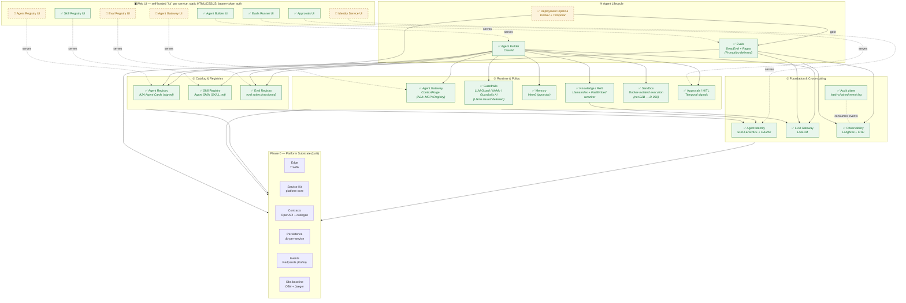
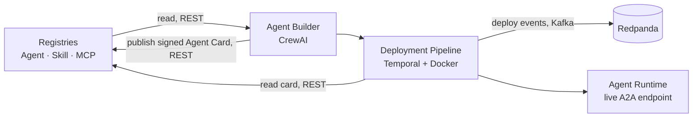

# Architecture

NotGovHarness is a locally-runnable reference implementation of a complete agentic platform:
16 "harnesses" across 4 dependency layers, all built on a shared Phase 0 substrate.

See [decisions.md](decisions.md) for the rationale behind every choice below and
[implementation-plan.md](implementation-plan.md) for build status/history in full detail.

**Status (updated 2026-09-25):** all 16 of 16 harnesses are built and merged to `main`. The map
below marks each node ✅ built/merged; a few anchors also changed from the original Phase 0 guess
once real research/building settled the actual choice — noted inline where that happened.

**Status (updated 2026-10-13):** a design-only pass added a "Web UI" layer on top of the 16
harnesses — see [decisions.md](decisions.md) D-096..D-100 and [design.md](design.md) for the
full rationale and screen-by-screen mockups. Three services already had a self-hosted `/ui`
(Skill Registry, Approvals/HITL, Evals Runner); this pass designs the same surface for the five
that didn't (Agent Builder, Agent Gateway/MCP, Eval Registry, Agent Registry, Identity Service).

**Status (updated 2026-10-17):** Agent Builder's `/ui` is built and merged to `main`
(`feat/ui-agent-builder`; D-096, D-101, D-103, D-104) — the first of the five. Four remain
planned: Agent Gateway/MCP, Eval Registry, Agent Registry, Identity Service.

## Platform map (harnesses + chosen anchors)



## Engine map

| Engine | Owning services | Started in compose |
|---|---|---|
| Postgres | LiteLLM, Builder, Evals, Agent Registry, Identity authz, Guardrails, ContextForge, Sandbox jobs, Approvals, Audit (hash-chained), Memory, Knowledge/RAG, Skill/Eval Registry, Deploy | Phase 0 (shared container, db-per-service); ✅ all rows above live |
| ClickHouse + Redis + MinIO | Observability (Langfuse) | ✅ built |
| MinIO (object store) | Skill Registry bundles, Eval Registry datasets (shared object store) | ✅ built |
| Vector (pgvector) | Memory, Knowledge/RAG — both on pgvector (D-060); Qdrant was the Phase-0-era alternative, never actually used | ✅ built |
| Temporal datastore | Approvals/HITL (built, D-048/D-049); Deployment Pipeline orchestration (built, D-087..D-095 — same shared Temporal instance) | ✅ built (both) |
| SPIRE datastore | Agent Identity | ✅ built |

Compose uses **profiles** so only the engines a given active service needs are started.

## Interconnect — connectors & surfaces

How the harnesses speak to one another. Full visual reference (control + data plane,
surfaces table, cross-cutting planes): the "Connectors & Surfaces" artifact.

**Connectors (protocols on the wire):** `REST/OpenAPI` (default, generated clients) ·
`OpenAI API` (→ LLM Gateway) · `MCP` (→ MCP Gateway → servers) · `A2A` (agent↔agent, signed
Agent Cards) · `SPIFFE Workload API` + `OAuth2` (Identity) · `OTLP` (→ Observability) ·
`Kafka` (async events) · `S3` (bundles/artifacts).

**Data plane — one request through a running agent:**

```mermaid
sequenceDiagram
    participant C as Caller
    participant ID as Identity
    participant RT as Agent Runtime
    participant GR as Guardrails
    participant MEM as Memory
    participant RAG as Knowledge/RAG
    participant GW as LLM Gateway
    participant MG as Agent Gateway
    participant SBX as Sandbox
    participant HITL as Approvals
    C->>ID: get scoped token (OAuth2)
    C->>RT: invoke task (A2A, mTLS/SVID)
    RT->>GR: check(input) (REST)
    RT->>MEM: retrieve memory (REST)
    RT->>RAG: retrieve grounding (REST, provenance)
    loop reason / act
        RT->>GW: chat/completion (OpenAI API)
        RT->>MG: call tool via Agent Gateway (MCP/A2A)
        RT->>SBX: run code (isolated, Docker — not E2B, D-050)
        RT->>HITL: approve risky action? (Temporal signal)
    end
    RT->>GR: check(output) (REST)
    RT->>MEM: persist (REST)
    RT->>C: result (A2A)
    Note over C,MG: every hop: mTLS (SPIFFE) + scoped token (OAuth2); all spans -> OTLP -> Observability
```

**Control plane — build & deploy:**



## Web UI layer (design pass, not yet built)

Full rationale: [decisions.md](decisions.md) D-096..D-100. Full view-by-view mockups:
[design.md](design.md).

**No new tech stack.** Three services already ship a self-hosted `/ui`: Skill Registry,
Approvals/HITL, Evals Runner. Each is one dependency-free `static/index.html` — inline CSS
(custom-property theme, light/dark) and inline JS (a bearer-token input + `fetch` wrapper that
attaches it as `Authorization: Bearer ...`), mounted by FastAPI at `/ui` via
`StaticFiles(html=True)`. The five new pages (Agent Builder, Agent Gateway/MCP, Eval Registry,
Agent Registry, Identity Service) reuse that exact shape rather than introducing React/Vue/a
build step — a second frontend stack living alongside the first would buy nothing functional
(D-096).

**The one new module:** going from 3 to 8 nearly-identical ~350-line files crosses the point
where copy-paste stops paying for itself. The proposal (not yet built) is a small
`platform_core.ui` static bundle — `platform-ui.css` (theme + layout + component styles) and
`platform-ui.js` (the bearer-token box, authed-fetch helper, empty/error/toast states) — served
once from `platform-core` and `<link>`/`<script>`-included by every `/ui` page, old and new
alike, which then owns only its own page-specific markup and API calls (D-097).

**Where each new UI talks to the platform:**

| UI | Backend it calls | Notes |
|---|---|---|
| Agent Builder UI | `agent-builder-service` (`GET/POST /builds`) | One `POST /builds` runs kickoff → sign → publish in one call — no separate "trigger"/"stream logs" step exists server-side, so the UI doesn't invent one. |
| Agent Gateway UI | `agent-gateway` façade (`GET/POST /mcp-servers`, `GET /tools`, `POST /tools/{name}/call`) | Talks to the façade, never to ContextForge's own `:4444` admin UI directly — keeps this platform's identity/scope gate in the loop (D-098, same seam D-043 closed). |
| Eval Registry UI | `eval-registry` (`GET/POST /suites`, `GET /suites/{name}/{version}/dataset`) | Same publish-via-pasted-bearer-token shape as Skill Registry's existing UI. |
| Agent Registry UI | `agent-registry` (`GET /agents`, `GET /agents/{name}/{version}/verify`) + `identity-service` `POST /cards/sign` for the secondary manual-publish view | Browse/verify is the landing view; manual sign-and-publish is secondary (D-100) since Agent Builder is the normal publisher. |
| Identity Service UI | `identity-service` (`GET /clients`, `POST /clients`, `GET /.well-known/jwks.json`) | Read-only client/scope/signing-key visibility plus client registration; deliberately no `/oauth/token` minting form (D-099). |

## Phase 0 substrate

The substrate is the only thing built in the first cycle. Every harness plugs into it. Two
service shapes are supported by the shared kit:

- **Greenfield service** — a FastAPI service owning its data (e.g. Agent Registry, Skill Registry).
- **Façade / adapter service** — wraps an upstream OSS project (LiteLLM, ContextForge, Langfuse,
  Temporal) behind the platform's OpenAPI contract + identity + OTel + events.

Detailed substrate design: see the Phase 0 spec in
[superpowers/specs/](superpowers/specs/).
