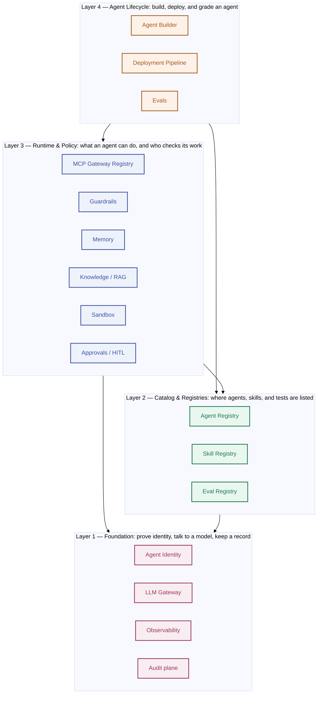

# NotGovHarness Runbooks

*2026-09-25 · Wil*

Ported from an earlier Claude session's knowledge-transfer document
([source](https://claude.ai/artifact/9Y2G9YwHw2NSr9twqaULFc)) into the repository so it lives
alongside the code it describes and can be kept current via normal PRs, same as every other doc
under `docs/`.

## What this platform is

NotGovHarness is a working demo of everything a company needs to safely run AI agents in
production — not just "call a chatbot API," but the full surrounding system: proving who's
making a request, keeping a tamper-proof record of what happened, checking outputs for unsafe
content, giving a human a chance to approve risky actions, letting agents remember things, and
deploying a finished agent so it can actually run on its own. It's built as **16 independent
building blocks ("harnesses")**, each one a small, focused service, organized into **4 layers**
that build on each other. Everything runs locally, on one laptop, via Docker — there is no cloud
deployment of this system itself.

**Why it's organized this way:** a real company platform team would build this incrementally,
and this project mirrors that — you cannot sensibly build "let an agent do things" (Layer 4)
before you have a way to prove *who* is asking (Layer 1). Each layer is a prerequisite for the
one above it, which is why this document is organized the same way.

## The whole platform, at a glance

*Reading this diagram: an arrow means "depends on" — Layer 4 depends on Layer 3 and Layer 2, and
so on down to Layer 1, which depends on nothing else in the platform. Bring layers up in that
order (1 → 2 → 3 → 4) and nothing will be missing what it needs.*

## How to use this document

Each file below follows the same structure every time: **what it's for (plain terms) → the
frameworks/tools it uses → the design tradeoffs and why → the key building blocks → every
file/script involved and what it does → how the important logic actually works → what to watch
out for when changing it → what commonly goes wrong.**

- **[Cross-Cutting Runbooks](cross-cutting.md)** — read this one first, regardless of what
  you're doing. Most real problems found while building this platform were one of five repeating
  patterns (Docker networking, expired tokens, Temporal timing, secrets/config, or "where do I
  even look"), not something specific to one service.
- **[Layer 1 — Foundation](layer-1-foundation.md)** — identity, the model gateway,
  observability, the audit log. Everything else depends on this layer.
- **[Layer 2 — Registries](layer-2-registries.md)** — the catalogs: published agents, skills,
  and eval suites.
- **[Layer 3 — Runtime & Policy](layer-3-runtime-policy.md)** — what an agent can actually do at
  runtime, and the guardrails/approvals/memory around it.
- **[Layer 4 — Agent Lifecycle](layer-4-agent-lifecycle.md)** — building an agent, deploying it
  for real, and grading whether it's good enough.

If you're **new to this project**, read the files in that order — each layer assumes you
understand the one before it. If you're **troubleshooting something broken right now**, start
with Cross-Cutting Runbooks.

**Companion documents in the code repository** (for anyone who wants the underlying source, not
just this summary): [`docs/decisions.md`](../decisions.md) is the full numbered log of every
real decision and bug found while building this (D-001 through D-111 as of this writing) — every
"D-0XX" reference in this document points there. [`docs/architecture.md`](../architecture.md)
has the engineering team's own architecture diagrams. [`docs/implementation-plan.md`](../implementation-plan.md)
is the build history.

**Note on freshness (updated 2026-10-23):** the original knowledge-transfer document was written
as of 2026-09-25, when all 16 harnesses had just been completed, and was ported into this repo
as-is. It has since been brought current: every layer file below now reflects D-096 through
D-111 — the self-hosted `/ui` page added to five more services (Agent Builder, MCP Gateway
Registry, Eval Registry, Agent Registry, Identity Service), the Agent Gateway → **MCP Gateway
Registry** rename (D-105, applied throughout this document now, not just in new material), and
the real gaps found while building those pages (D-109 no CORS, D-110 unauthenticated client
registration, D-111 no SPIFFE ID uniqueness check). See `docs/design.md` for the full per-page
view specs and `docs/decisions.md` for every decision this document references.
