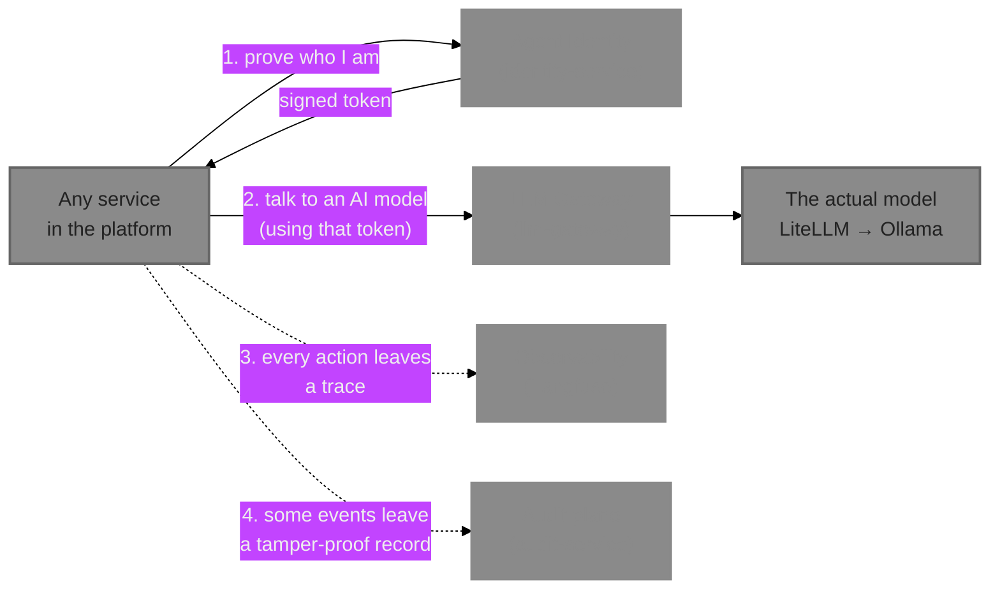

# Layer 1 — Foundation & Cross-cutting

Everything else in this platform depends on this layer. In plain terms: before an agent can do
anything, the platform needs to know *who* is asking (Agent Identity), agents need a safe way to
*talk to an AI model* (LLM Gateway), the team needs to *see what happened* (Observability), and
there needs to be a *tamper-proof paper trail* (Audit plane). Nothing above this layer can be
trusted if this layer isn't solid.

*Every other layer's services check in with Agent Identity on every request, and most call LLM
Gateway whenever they need an AI model. Observability and the Audit plane run quietly in the
background, watching everything.*

## Objective

Think of this layer as the security guard, the phone line, the security camera, and the notary
public for the whole platform:

- **Agent Identity is the security guard.** Every single request between services in this
  platform carries a badge (a token) that Agent Identity issued and can be checked. Nothing gets
  to act without one.
- **LLM Gateway is the phone line to the AI model.** No service calls the underlying AI model
  directly — they all go through this one switchboard, so the platform can control who's allowed
  to use the model and see what it costs.
- **Observability is the security camera.** It records what happened across every service so a
  person can later see the full path a request took, how long each step took, and where
  something went wrong.
- **Audit plane is the notary public.** For a smaller set of especially important events, it
  keeps a permanent, tamper-evident written record — like a notarized document, if anyone alters
  it after the fact, that tampering is detectable.

The business reason this layer exists first: a platform that lets AI agents take real actions
needs to answer "who did this, and can we prove it wasn't tampered with" before it can be
trusted with anything more ambitious — that's a compliance and trust requirement, not just an
engineering nicety.

## Frameworks and technology choices

| Service | Core technology | What it's for |
|---|---|---|
| Agent Identity | OAuth2 (industry-standard login/permission protocol) + RS256 signed tokens (`PyJWT`), SPIFFE/SPIRE (industry-standard machine identity) | Issuing and checking the "badges" every service uses |
| LLM Gateway | LiteLLM (an open-source AI-model switchboard), fronted by our own thin proxy | Routing every AI model call through one controlled door |
| Observability | Langfuse v4 (an off-the-shelf, self-hosted product — no custom code), OpenTelemetry (the industry-standard tracing format) | Recording the path and timing of every request |
| Audit plane | Plain Python + a hash-chain (the same mathematical idea git and blockchains use to detect tampering) | A tamper-evident written record of real events |

**A detail worth knowing:** Agent Identity and LLM Gateway are both custom-built services with
real application code (`src/` directories full of Python). Observability is *not* — Langfuse is
a ready-made open-source product this platform simply configures and runs; there is no
`services/observability/` folder in the codebase because there's no custom code to put there.

## Design choices and tradeoffs

**No separate signing key for Agent Cards (D-029).** Later on, Agent Builder publishes signed
"Agent Cards" describing each AI agent. Rather than setting up a second, separate cryptographic
trust system just for that, Agent Identity reuses the exact same signing key it already uses for
login tokens. Tradeoff: simpler to build and operate (one key, one place callers check), at the
cost of not being interoperable with an outside system that expects a fully separate signing
authority for cards — acceptable for a self-contained reference platform, would need revisiting
before talking to a truly external system.

**Identity-service verifies its own tokens in-process, not over the network (D-032).** Every
*other* service checks a caller's badge by calling out over the network to Agent Identity's
public key list. Agent Identity itself can't do that for its own badges — asking itself over the
network while it's still in the middle of answering that very request would freeze up (found
live, a real deadlock, not a hypothetical). Fixed by having it check its own badges directly in
memory, since it already holds the signing key. A narrow, deliberate exception to the platform's
general rule, not an inconsistency.

**Ephemeral signing key, restart invalidates every badge (`config.py`).** In development, Agent
Identity generates a brand-new signing key every time it restarts, rather than keeping one
permanently in a secrets vault. This means every previously-issued badge stops working the
moment the service restarts. Acceptable because badges only last 5 minutes anyway — a production
deployment would need a real key-management system (explicitly out of scope for this reference
platform).

**No dedicated topic-discovery system for the Audit plane.** The Audit plane only listens to one
Kafka "channel" today (`platform.example.v1`), hardcoded in a short list rather than
auto-discovered. Simpler to build; extending it to cover a new kind of event is a one-line
addition to that list, not a redesign — a deliberate "build the simple thing now" choice, not an
oversight.

**LLM Gateway's timeout was raised from 30s to 120s (D-082) after a real failure**, not
preemptively: a judge-style AI request (used later by the Evals layer) genuinely takes longer
than a normal chat reply, and the first version's timeout cut it off mid-answer. Fixed once the
real failure was observed, not guessed at up front — the whole platform favors "build it, watch
it break for a real reason, then fix that specific thing" over speculatively engineering for
problems that might never happen.

**Agent Identity's `/ui` page is read-only for clients/scopes/signing keys, plus the one write
that genuinely needs a form — registering a new client (D-099).** There's deliberately no
"mint a token" playground: `POST /oauth/token` takes a `client_id`/`client_secret` pair as plain
form fields, exactly the credential-in-a-browser-form shape already rejected for every other
registry's publish UI — adding it to the one service that actually owns these secrets would be
the same anti-pattern with higher stakes. Operators mint tokens the way every other flow in this
platform already does: curl/httpx against `/oauth/token` directly.

**Two real gaps in `POST /clients` were found live while building that page, not fixed, and
surfaced loudly instead (D-110, D-111).** `POST /clients` has no authentication gating at all —
confirmed by registering a client with a plain, unauthenticated `curl` call that succeeded and
self-granted whatever scopes it asked for. Separately, `spiffe_id` has no uniqueness constraint
either — two different clients were registered live with the identical SPIFFE ID, and both
succeeded. Both are real inconsistencies on a service whose entire purpose is being the
platform's trust root, not documented, narrow tradeoffs the way D-043/D-047's loosenings
elsewhere are — logged honestly and surfaced in the UI's warning banner rather than quietly
patched or silently left undocumented. Fixing either is a backend trust-model decision (who's
allowed to register a client? reject or dedupe a colliding SPIFFE ID?), deliberately left for a
dedicated pass rather than a quick patch bundled into a `/ui` branch.

## Key components

**Agent Identity (`identity-service`, port 8090).** Issues and verifies badges (OAuth2 tokens);
also signs Agent Cards later on. Runs alongside SPIRE (separate infrastructure containers:
`spire-server`, `spire-agent`, `spire-bootstrap`) which handles a different, lower-level kind of
machine-to-machine trust (mutual TLS certificates) — SPIRE and identity-service currently run
side by side rather than being fully wired together in code. Has its own self-hosted browsing
page at `/ui` (D-099): a **Clients** tab (list + register, with a prominent warning banner
covering D-110 and D-111) and a **Signing Keys** tab (read-only view of
`/.well-known/jwks.json`).

**LLM Gateway (`llm-gateway`, port 8099).** The one door every AI model call passes through.
Behind it sits LiteLLM (port 4000, its own container), which itself talks to the developer's own
locally-installed Ollama (the actual AI model, running natively on the host machine — not in a
container, to get full hardware acceleration).

**Observability (Langfuse, port 3000).** No custom code — an off-the-shelf product, configured
via `docker-compose.yml` only, backed by its own ClickHouse (analytics database) and MinIO (file
storage).

**Audit plane (`audit-service`, port 8091).** Listens for events and writes them into a
hash-chained log — each entry's fingerprint depends on the previous entry's fingerprint, so
changing any past entry breaks every fingerprint after it, the same tamper-detection idea used in
git and blockchains.

**The shared foundation underneath all four (`packages/platform-core/`).** Not one of the 16
harnesses itself, but worth knowing about: every service in this entire platform, not just this
layer, is built from this shared internal toolkit — it provides the standard way to build the
web app, connect to the database, handle errors consistently, and check a caller's badge. When
you see the same patterns repeat across many services, this is why.

## Every file, script, and artefact in this layer

### `services/identity-service/`

| File | What it does |
|---|---|
| `src/identity_service/config.py` | The settings: how long a badge lasts (5 minutes), the maximum "delegation" chain depth, where the signing key comes from |
| `src/identity_service/keys.py` | Creates the cryptographic signing key at startup (or loads one if configured) |
| `src/identity_service/tokens.py` | The actual badge-issuing and badge-checking logic — the heart of this service |
| `src/identity_service/cards.py` | Signs Agent Cards using the same key as badges |
| `src/identity_service/models.py` | The database table listing every registered caller (`clients`) and what they're allowed to do |
| `src/identity_service/main.py` | Wires everything into a web service: the `/oauth/token` (get a badge), `/.well-known/jwks.json` (the public key list anyone can check a badge against), `/cards/sign`, and `/clients` endpoints |
| `static/index.html` | The Clients + Signing Keys browsing/registration page at `/ui` |
| `migrations/versions/0001_clients.py` through `0017_deployment_pipeline_scope.py` | Seventeen incremental database setup scripts — the first creates the caller-registry table; every one after that grants a newly-built service permission to call other services, one small addition per new harness built. This growing list is itself a record of the platform's own build history. |
| `migrations/versions/0018_rename_agent_gateway_scope.py` | Updates the two live clients that already held the old `agent_gateway:call` scope string to `mcp_gateway_registry:call` in place (D-105) — the historical migrations above it are left untouched, since they're already-applied history. |

### `services/llm-gateway/`

| File | What it does |
|---|---|
| `src/llm_gateway/config.py` | Settings: where LiteLLM lives, how long to wait for a model reply (120 seconds) |
| `src/llm_gateway/main.py` | The entire service — one endpoint, `POST /chat/completions`, that checks the caller's badge and forwards the request to LiteLLM |
| `infra/litellm/config.yaml` | LiteLLM's own configuration: which model it offers (`qwen3.8`) and where to find it (the host machine's Ollama) |

### Observability

No application files — configured entirely through `docker-compose.yml` (the Langfuse
web/worker containers and their settings).

### `services/audit-service/`

| File | What it does |
|---|---|
| `src/audit_service/config.py` | Settings, including the list of event channels this service listens to |
| `src/audit_service/chain.py` | The tamper-detection math itself — pure logic, no database calls, so it can be tested on its own |
| `src/audit_service/writer.py` | Reads the last entry in the log and appends a new one on top of it |
| `src/audit_service/verifier.py` | Walks the entire log from the beginning, recomputing every fingerprint, to confirm nothing was altered |
| `src/audit_service/models.py` | The database table holding the log itself |
| `src/audit_service/main.py` | Wires up the Kafka listener (the only way events get in — there is no "add an entry" button) and the two read endpoints (`/audit/records`, `/audit/verify`) |
| `migrations/versions/0001_audit_log.py` | The one and only database setup script — this table's shape hasn't changed since it was built |

## How the key logic actually works

**Issuing a badge — `issue_autonomous_token()` (`identity_service/tokens.py`).** When a service
asks for a badge, this function builds a small data packet: who's asking, what they're allowed
to do, when the badge expires (5 minutes from now), and a unique badge ID. It then
cryptographically signs that packet with the service's private key. Anyone holding the matching
public key (published at `/.well-known/jwks.json`) can verify the badge is genuine and hasn't
been altered, without ever needing to ask Agent Identity directly — the same idea as a wax seal
on a letter.

**"Acting on someone else's behalf" — `issue_delegated_token()`.** Sometimes one agent needs to
act *for* a human or another agent, not just for itself (this is the `alice` delegation demo
built into the platform). This function checks that the requested permissions are a subset of
what *both* the actor and the person they're acting for are separately allowed to do — an agent
can never gain more power by delegating than either party already had alone. It also tracks how
many times a request has been "re-delegated" (agent A acting for agent B acting for a human,
say) and refuses to let that chain get more than 3 hops deep, so permission can't be indefinitely
laundered through a long chain of hand-offs.

**Checking a badge — `verify_own_token()` / the shared checking logic other services use.**
Given a badge, this decodes it using the public key, confirms the signature is genuine and the
expiry hasn't passed, and hands back who the caller is (and, for a delegated badge, who they're
acting for). Every scope-gated endpoint across the whole platform runs through this same check
before doing anything else.

**Forwarding a model request — `llm-gateway`'s one real function.** After checking the caller's
badge and confirming they're allowed to call the model, this swaps the caller's own badge for a
separate, internal credential that only `llm-gateway` itself knows (the caller never sees or
needs LiteLLM's own key), then forwards the request to LiteLLM and returns whatever comes back.
This is the credential hand-off pattern: callers prove who *they* are to the platform; the
platform itself proves who *it* is to LiteLLM — two separate trust relationships, deliberately
not one shared secret.

**Recording a tamper-evident entry — `append_event()` (`audit_service/writer.py`).** Reads the
fingerprint of the most recent log entry, computes a new fingerprint that mathematically covers
both this new entry's own content *and* that previous fingerprint, and saves the new row.
Because each fingerprint depends on the one before it, altering any past entry — even by one
character — changes its fingerprint, which then no longer matches what the *next* entry recorded,
and that mismatch cascades forward through every entry after it. This is exactly why
`GET /audit/verify` can walk the whole log and immediately spot the *first* point where something
was changed.

**Checking the whole log — `verify_chain()`.** Walks every entry from the very first to the very
last, recomputing each fingerprint from scratch and comparing it to what's stored. The moment one
doesn't match, it stops and reports exactly which entry broke the chain — not just "something's
wrong somewhere."

## What to watch out for when maintaining or enhancing this layer

- **Adding a new service that needs to call others?** Copy the newest identity-service migration
  file (e.g. `0017_deployment_pipeline_scope.py`) as your template — it's the established,
  consistent way to register a new caller and grant it exactly the permissions it needs, nothing
  more.
- **Restarting `identity-service` invalidates every outstanding badge instantly** (the signing
  key is regenerated fresh each time). If you're debugging something and restart it, every token
  you're holding stops working — get a fresh one.
- **Never let a service call Agent Identity's own network endpoint from inside Agent Identity
  itself** — this is the exact deadlock D-032 found live. If you're touching `identity-service`'s
  own auth-checking code, it should keep using the in-process check, not the network-based one
  every other service uses.
- **If a future change needs a truly separate trust root for Agent Cards** (e.g. talking to an
  outside, non-NotGovHarness system), that's a deliberate departure from D-029's "one shared key"
  choice — flag it as a real design decision, not a quiet code change.
- **Langfuse's API shape changed between major versions** (the currently-used v2 Observations
  API replaced an older v1 one that 404s under this deployment) — if you're integrating
  something new with Observability, check which API version this deployment actually runs before
  copying an example straight from Langfuse's own docs.
- **The Audit plane has no way to add an entry except through Kafka.** If a future feature seems
  to need a "manually add an audit entry" button, that breaks the whole point of this layer — the
  tamper-evidence guarantee depends on ingestion being exclusively event-driven, not directly
  writable by any caller. Don't add one.
- **`GET /audit/verify` reads the entire table into memory on every call**, with no pagination.
  This is fine at a reference-platform scale; if the audit log ever grows large, this is the
  first thing that will need to change (e.g. checkpointed verification instead of always
  re-checking from the very first entry).

## Common failures

- **A token you know is recent gets rejected as expired.** See the Cross-Cutting Runbooks file's
  "Token TTLs" section — badges only last 5 minutes, and this is almost always that, not a real
  bug.
- **A new client can't authenticate at all.** Check its database-setup migration actually ran
  (`docker compose logs identity-service` shows this on startup), and that the password you're
  using matches exactly what was set up in that migration.
- **A client was registered with scopes or a SPIFFE ID nobody intended.** `POST /clients` has no
  authentication and no SPIFFE-ID uniqueness check (D-110, D-111) — this isn't a bug to debug,
  it's a known, disclosed gap; anyone with network access to this endpoint can currently do this.
- **Model calls timing out on anything complex** (a long AI-judged evaluation, a multi-step agent
  task) — the 120-second timeout was already raised once for exactly this reason; if it's still
  not enough, that's the setting to revisit, not the caller's own retry logic.
- **Traces not showing up in Observability** — check the shared trace-collection point
  (`otel-collector`) first; it's the funnel every service's tracing goes through before reaching
  Langfuse, and a silent drop there is more common than Langfuse itself being down.
- **Legacy-looking Langfuse API calls returning 404** — this deployment runs a newer Langfuse
  version whose older-style endpoints were retired; use the newer API shape.
- **Events not appearing in the Audit plane** — first confirm the event actually made it onto
  its Kafka channel at all (see the Cross-Cutting Runbooks file's debugging playbook), then check
  `audit-service`'s own logs — same order you'd check any event-driven flow in this platform.
