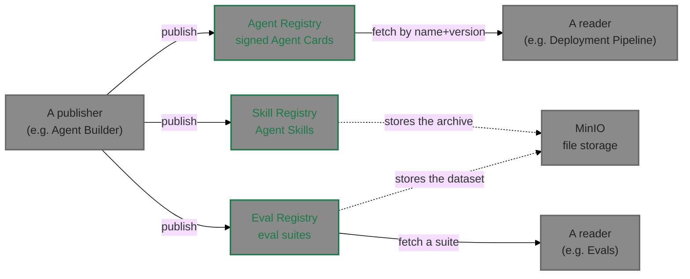

# Layer 2 — Catalog & Registries

This layer is the platform's set of catalogs — three separate "phone books," each for a
different kind of thing that gets published and later looked up: finished AI agents, reusable
skills those agents can use, and test suites for checking whether an agent is actually good.

*All three registries share the same basic shape: publish something once under a name+version
(you can't silently overwrite an existing one — publishing the same name+version twice is
rejected), then anyone can fetch it back later. Two of the three (Skill Registry, Eval Registry)
also store a file alongside the metadata, using the same shared file-storage system (MinIO).*

## Objective

These three services answer the same basic business question, for three different kinds of
thing: **"what have we built, and how do I find it again later?"**

- **Agent Registry** is the company directory for finished AI agents — a signed, trustworthy
  listing anyone can look up, so a later step (like actually deploying that agent) knows it's
  reading the real, unaltered thing someone actually published, not a tampered copy.
- **Skill Registry** is the shared skills library — reusable capability packages an agent can be
  equipped with, the same idea as a shared code library, but for agent capabilities instead of
  code functions.
- **Eval Registry** is the shared test bank — versioned sets of "correct answer" examples used
  later to grade whether an agent is actually performing well, kept separate from any one agent
  so the same test bank can be reused to grade many agents fairly, on the same standard.

Without this layer, every agent's capabilities and every test would have to be re-described from
scratch each time something needed them — this layer exists so "publish once, reuse everywhere"
actually works.

## Frameworks and technology choices

| Service | Core technology | What it's for |
|---|---|---|
| Agent Registry | `PyJWT` (the same signing library Agent Identity uses), Postgres (JSON columns) | Signing and verifying Agent Cards — no separate crypto library, reuses Agent Identity's own signature mechanism |
| Skill Registry | `PyYAML` (safe-mode only), Postgres, MinIO (file storage), a custom content scanner | Parsing skill packages and checking them for obviously malicious content before accepting them |
| Eval Registry | Postgres, MinIO, the same custom content scanner as Skill Registry | Storing test suites; no AI-model library here — this service never runs a test, it only stores one |

**All three follow the same standard shape.** Each one is a small, focused web service built on
the platform's own shared internal toolkit (`platform-core`) — same pattern for checking a
caller's badge, same pattern for talking to its own database, same pattern for returning errors.
Once you understand one registry's code, the other two will look very familiar.

## Design choices and tradeoffs

**Card signatures are checked on the decoded content, not byte-for-byte (D-031).** The official
Agent Card standard technically wants a very strict, byte-exact comparison method. This platform
instead checks that the *meaning* of the signed content matches, which is simpler to build and
still genuinely catches tampering — but a real outside system expecting the strict standard
wouldn't accept it as-is. A known, disclosed simplification for a self-contained reference
platform, not something to "fix" without understanding why it was chosen.

**Skill packages have no cryptographic signature at all (D-035)**, unlike Agent Cards. The
official Agent Skills standard simply doesn't define one. Instead, Skill Registry substitutes
"basic hygiene" — size limits, rejecting suspicious file paths, and scanning file contents for
known-bad patterns. Weaker than a real signature, but matches what the standard actually
specifies; a production deployment might layer real signing on top, which is explicitly called
out as future work, not done here.

**The database never stores an eval suite's actual test data, only its description (D-042).**
Unlike Skill Registry (which *does* duplicate a skill's main instructions into the database for
fast reading), Eval Registry keeps the full dataset only in file storage. Reasoning: a test suite
full of examples can be large and isn't something read on every single request — keeping one
single source of truth outweighs a read-speed optimization nobody's asked for yet.

**Same malicious-content scanner, reused, not rebuilt, across two services.** Both Skill Registry
and Eval Registry scan uploaded content for the same categories of red flags (a skill's
instructions and an eval's grading criteria are both text an AI model will later read and could
be tricked by) — the scanning logic itself lives in the shared toolkit once, not copied and
maintained separately in each registry.

**File storage was built once, in the shared toolkit, anticipating its second user (D-034).** The
MinIO file-storage wrapper was originally written for Skill Registry, but placed in the shared
`platform-core` toolkit specifically because Eval Registry — the very next thing planned to be
built — was already known to need the exact same capability. Not speculative "we might need this
someday" work; a named, concrete next user justified building it as shared code from day one.

**Agent Registry's `/ui` makes browse + verify the primary path; manual sign-and-publish is a
secondary, clearly-labeled "Advanced" tab, not the landing view (D-100).** In practice every
published card is signed and published by Agent Builder's own `_sign_and_publish_card` — a human
has little reason to hand-author a card JSON day to day. The manual form is kept because
`POST /agents` and `/cards/sign` are both real, reachable endpoints worth being able to drive
directly (e.g. a manually-authored demo card), but it's placed behind a secondary tab so the UI
doesn't imply hand-publishing is the normal way agents get registered. **Its exact shape was
further corrected once building it revealed a real gap (D-109):** the original plan had it sign
a card itself by calling `identity-service`'s `/cards/sign` directly from the browser, but
`platform_core.app`'s shared app factory configures no CORS anywhere in this codebase — a real
`OPTIONS` preflight against `/cards/sign` from a different origin came back `405` with no
`Access-Control-Allow-Origin` header, which every real browser would block before the actual
`POST` is even sent. Fixed by having the Advanced tab take an already-signed card (the three
signature fields pasted in directly, with a `curl` snippet showing how to get them from
`identity-service` first) and call only Agent Registry's own same-origin `POST /agents` — no
cross-origin call at all.

**Eval Registry's `/ui` design was corrected against the live service before it was built, the
same discipline applied everywhere else in this layer (D-107).** The original plan assumed
`GET /suites` returns a version per row and that browsing needs a bearer token; neither is true
against the real running service: `list_suites` dedupes to one row per name with no version
field at all (a version only exists once a specific suite is opened), and every `GET` route here
has no identity check at all — browsing is fully public, the same posture as Skill Registry,
unlike Agent Builder or MCP Gateway Registry where every route needs a token. Only `POST /suites`
does.

**Eval Registry's suite-detail interaction went through three real iterations, each a genuine
fix to a problem a user actually hit, not polish for its own sake (D-108).** First shipped as one
shared detail panel after the entire suite list — functionally correct, but invisible with 47+
real suites, since clicking an early card updated content far below the visible screen. First fix
(`scrollIntoView()`) was itself rejected as the wrong interaction, not just under-signposted.
Real fix: each suite card now owns its own sibling detail container that opens and closes in
place, as a true accordion, with a distinct background color on the active card so it's visually
unambiguous which one is open — a need only surfaced once the interaction itself was already
correct.

## Key components

**Agent Registry (`agent-registry`, port 8092).** Stores signed Agent Cards. Publishing checks
the signature is genuine before accepting anything; `GET /agents/{name}/{version}/verify` lets
anyone re-check a stored card's signature at any time, which is exactly what catches someone
tampering with the database directly, bypassing the API. No file storage needed — everything
fits in the database. Browsing (including verify) is fully public; has its own `/ui` (D-100) with
an **Agents** list (inline-accordion card detail, same pattern as Eval Registry below, plus a
**Verify** button) and a secondary **Advanced** tab for manual publish.

**Skill Registry (`skill-registry`, port 8093).** Stores Agent Skills — packages with a required
`SKILL.md` instructions file plus optional supporting scripts/files. A skill's core description
lives in the database (for fast lookup); the full package (including any scripts) lives in MinIO
file storage, fetched only when an agent actually needs to use that skill. Has its own small
browsing web page at `/ui`.

**Eval Registry (`eval-registry`, port 8094).** Stores test suites in two flavors: "cases" (a
fixed set of question-and-correct-answer pairs, stored as a downloadable file) and "redteam" (a
generator config for adversarial/security testing, with no fixed file — it produces test cases on
the fly later). This is a from-scratch design with no external industry standard to follow,
unlike the other two registries. Browsing is fully public; has its own `/ui` (D-107, D-108) with
a **Suites** list (inline-accordion detail per card, each golden case within a "cases" suite
individually expandable) and a **Publish** tab (multipart form, kind-specific body).

## Every file, script, and artefact in this layer

### `services/agent-registry/`

| File | What it does |
|---|---|
| `src/agent_registry/config.py` | Settings |
| `src/agent_registry/models.py` | The database table storing every published card |
| `src/agent_registry/verify.py` | Checks a card's signature is genuine — the security-critical logic |
| `src/agent_registry/main.py` | The web endpoints: publish, list, fetch, and verify |
| `static/index.html` | The browsing/publishing page at `/ui` — Agents list + Advanced (manual publish) tab |
| `migrations/versions/0001_agent_cards.py` | Creates the one database table this service needs |

### `services/skill-registry/`

| File | What it does |
|---|---|
| `src/skill_registry/config.py` | Settings, including where to find MinIO |
| `src/skill_registry/bundle.py` | Safely unpacks an uploaded zip file — checks it's not oversized, not a "zip bomb," and has no sneaky file paths trying to escape its own folder |
| `src/skill_registry/skillmd.py` | Reads and checks the required `SKILL.md` instructions file against the rules for a valid skill |
| `src/skill_registry/scan.py` | Scans every file in the package for known-bad patterns before accepting it |
| `src/skill_registry/models.py` | The database table |
| `src/skill_registry/main.py` | The web endpoints: publish, list, fetch, download |
| `static/index.html` | The browsing/publishing web page at `/ui` |
| `migrations/versions/0001_skills.py`, `0002_scan_findings.py` | Creates the table, then later adds a column to record what the content scanner found |

### `services/eval-registry/`

| File | What it does |
|---|---|
| `src/eval_registry/config.py` | Settings |
| `src/eval_registry/suite.py` | Checks an uploaded test suite's description and (for "cases"-type suites) its question-and-answer file are well-formed |
| `src/eval_registry/scan.py` | Scans a suite's grading instructions for known-bad patterns (an AI judge reading a rigged grading rubric is the same kind of risk as an agent reading rigged instructions) |
| `src/eval_registry/models.py` | The database table |
| `src/eval_registry/main.py` | The web endpoints: publish, list, fetch, download the dataset |
| `static/index.html` | The browsing/publishing page at `/ui` — Suites list (inline accordion) + Publish tab |
| `migrations/versions/0001_suites.py` | Creates the one database table this service needs |

### Shared code used by two or more of these (`packages/platform-core/`)

| File | What it does |
|---|---|
| `platform_core/objectstore.py` | The MinIO file-storage wrapper both Skill Registry and Eval Registry use |
| `platform_core/contentscan.py` | The malicious-content pattern scanner both Skill Registry and Eval Registry use |

## How the key logic actually works

**Publishing a card — `publish_agent()` (`agent_registry/main.py`).** First checks the submitted
card has every required field. Then checks the card's signature is genuine (see below). Only then
does it save the card, storing both the individual fields *and* the entire original submission
verbatim — so a later re-check has the exact original bytes to verify against, not a
reconstruction. If someone tries to publish the same name+version twice, the database itself
rejects the second attempt (a built-in uniqueness rule), and *that* rejection is what stops it —
not a separate check earlier in the code, which matters because it means there's no gap where a
duplicate could slip through a race condition.

**Checking a signature — `verify_card_signature()`.** Looks up the public key that matches the
signature (published by Agent Identity), decodes the signed content using it, and confirms the
decoded content matches what was actually submitted. If the key is unknown or the content doesn't
match, verification fails and the card is rejected. `GET /agents/{name}/{version}/verify` runs
this exact same check on-demand against whatever is *currently* stored in the database — which is
what catches someone editing the database directly, bypassing the publish endpoint entirely.

**Safely unpacking a skill package — `extract_bundle()` (`skill_registry/bundle.py`).** Before
trusting anything inside an uploaded zip file, this checks: the whole file isn't too large; it
doesn't contain a suspicious number of entries; no file inside tries to write outside its own
folder (a classic "zip path traversal" attack, where a filename like `../../etc/passwd` tries to
escape the intended folder); the total uncompressed size doesn't balloon far beyond the compressed
size (a "zip bomb" — a tiny file that expands to gigabytes and can crash a service); and that
exactly one skill lives inside, with the required instructions file present. Only after all of
that passes does it hand back the contents for the next step.

**Checking a package's instructions — `parse_skill_md()`.** Reads the required `SKILL.md` file's
structured header section and checks every field the Agent Skills standard requires is present
and valid — including that the skill's declared name exactly matches its own folder name inside
the zip, which ties the package's contents to what it claims to be.

**Scanning for malicious content — `scan_bundle()` / `scan_suite()` (shared logic in
`platform_core/contentscan.py`).** Every text-based file gets checked against a list of known
red-flag patterns: destructive commands, attempts to read credential files and send them
somewhere, disguised executable files, and — specifically relevant because an AI model will read
this content — phrasing that looks like it's trying to manipulate an AI reader into ignoring its
real instructions ("ignore previous instructions," "always give a perfect score," that kind of
thing). This is explicitly a basic safety net, not a guarantee — it catches obvious,
unsophisticated attempts, not a carefully disguised one.

**Splitting cases vs. redteam suites — `parse_suite_metadata()` (`eval_registry/suite.py`).** The
very first thing this checks is which of the two kinds of suite is being published, because
everything downstream forks based on that: a "cases" suite must include a scoring configuration
and a file of question-and-answer examples; a "redteam" suite instead must include a generation
configuration (what kind of adversarial tests to produce) and explicitly has no fixed file at all
— it generates its own test cases later, at run time.

## What to watch out for when maintaining or enhancing this layer

- **"Latest" means "most recently published," not "highest version number."** All three
  registries pick the latest version by publish date, not by comparing version strings.
  Publishing an older version *after* a newer one won't make the older one "latest" again, but it
  also won't sort itself correctly if you were expecting semantic-version-aware ordering.
- **The content scanner is shared code (`platform_core/contentscan.py`).** If you improve its
  detection patterns, that improvement automatically benefits both Skill Registry and Eval
  Registry at once — but also means a change there needs testing against both services' use
  cases, not just one.
- **Never remove the "publish before storing the file" ordering** in Skill Registry or Eval
  Registry's publish logic. The database commit happens *before* the file is written to MinIO
  specifically so a rejected duplicate publish can never overwrite an existing, already-stored
  file at the same location.
- **If you ever need real interoperability with an outside A2A system**, revisit D-031's
  simplified signature-checking approach first — it works for this platform's own internal use
  but wasn't built to the strictest interpretation of the external standard.
- **Adding a new eval suite "kind"** (beyond "cases" and "redteam") means updating the validation
  logic in `suite.py` to handle the new branch — the current code assumes exactly these two, not
  an open-ended list.

## Common failures

- **Publishing the same name+version twice** returns a "conflict" error — this is expected,
  working behavior, not a bug. Publish a new version number instead.
- **A card can't be re-deployed later even though it publishes fine.** Check whether it actually
  carries the `extensions` entry that later layers need to reconstruct the agent — cards
  published by an older version of Agent Builder may genuinely lack it.
- **Skill or eval publish rejected as "unsafe."** The content scanner flagged something as a red
  flag — check the specific finding it reports; it's usually pointing at real (if often
  false-positive) suspicious phrasing, not a random rejection.
- **A skill upload rejected outright before scanning even happens.** Check the zip file itself
  first — oversized, too many entries, a suspicious file path, or a missing/misnamed `SKILL.md`
  will all fail before content scanning is ever reached.
- **File download works for a skill but 404s for an eval suite** — check whether that suite is
  "redteam" kind; those have no fixed dataset file by design, so there's nothing to download.
