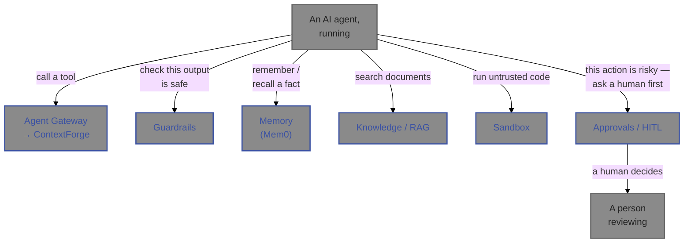

# Layer 3 — Runtime & Policy

> **Note on naming:** this file is ported verbatim from the original knowledge-transfer document
> and predates D-105 (the rename of Agent Gateway to **MCP Gateway Registry**). It still says
> "Agent Gateway" throughout, matching the name at the time it was written — see the runbooks
> [README](README.md) for why this isn't rewritten, and `docs/decisions.md` D-105 for the rename
> itself.

This is the biggest layer — six services — because it covers everything an agent actually touches
while it's running: the tools it's allowed to call, the safety checks on what it says, its
long-term memory, its ability to search documents, a safe place to run code, and the ability to
pause and ask a human before doing something risky.

*Every one of these six is optional on any given request — an agent doesn't have to call a tool,
doesn't have to check memory, doesn't have to run code. They're all capabilities an agent can
draw on, not a fixed pipeline every request passes through.*

## Objective

This layer answers: **"now that an agent is running, what is it actually allowed to do, and
who's watching?"**

- **Agent Gateway** is the tool room — agents don't get direct access to external tools/systems;
  they check them out through here, so there's one controlled door and one place to see what's
  being used.
- **Guardrails** is the content moderator — checks text (going in or coming out) for unsafe
  patterns before it's acted on.
- **Memory** is the agent's notebook — lets an agent remember facts across separate conversations
  instead of starting from zero every time.
- **Knowledge / RAG** is the research assistant — lets an agent search a company's own documents
  and answer questions grounded in them, with the source cited.
- **Sandbox** is the supervised testing room — a safe, walled-off place to run code an agent
  wrote, so a mistake or a malicious instruction can't reach anything real.
- **Approvals / HITL** ("human in the loop") is the manager's sign-off — for actions risky enough
  to warrant it, the agent pauses and a real person has to approve, reject, or edit the request
  before it proceeds.

The common thread: this layer is what makes it safe to let an agent actually *do* things, not
just talk.

## Frameworks and technology choices

| Service | Core technology | What it's for |
|---|---|---|
| Agent Gateway | ContextForge (an off-the-shelf, open-source tool-gateway product, IBM's `mcp-context-forge`), fronted by our own thin proxy | Speaks MCP (the emerging industry-standard protocol for AI tool-calling) so any MCP-compatible tool can be wired in |
| Guardrails | Three separate open-source safety libraries run together: LLM Guard, NeMo Guardrails, Guardrails AI | Defense in depth — three independent checks rather than trusting one |
| Memory | Mem0 (an open-source agent-memory library), on the platform's shared Postgres database (using its `pgvector` extension for similarity search), FastEmbed (a lightweight, in-container AI embedding model) | Remembering and recalling facts |
| Knowledge / RAG | LlamaIndex (an open-source retrieval-augmented-generation toolkit), the same Postgres+pgvector pattern, FastEmbed again for both embedding and re-ranking | Document search grounded in real sources |
| Sandbox | Plain Docker containers, no specialized sandboxing product | Running untrusted code in a walled-off, disposable container |
| Approvals / HITL | Temporal (an open-source workflow engine, already used elsewhere in this platform) | Durably pausing a process until a human responds, even across restarts |

**A pattern worth knowing:** four of these six (Guardrails, Memory, Knowledge/RAG, and indirectly
Sandbox) wrap real, actively-maintained open-source AI/ML libraries rather than building the
underlying capability from scratch — this layer's own code is mostly the *glue* connecting those
libraries to the platform's identity, database, and API conventions, not the AI/ML logic itself.

## Design choices and tradeoffs

**Sandbox uses plain Docker, not a specialized product, after checking the alternative's real
cost (D-050).** The original plan named a hosted sandboxing product ("E2B") as OSS and
self-hostable. Checking its actual self-hosting requirements found it needs a heavyweight cluster
setup costing roughly $1,250/month at minimum — completely at odds with "this whole platform runs
on one laptop." Built to the *same shape* (submit code, get output back, network-isolated by
default) using plain Docker containers instead. The real upgrade path to a production-grade
sandbox is documented, not hidden or pretended unnecessary.

**Guardrails runs all three safety checks every time, on purpose, not stopping at the first
hit.** A finding from *any* of the three libraries blocks the content, but every check still runs
and every finding is recorded — "defense in depth," not "first alarm wins." Costs a little more
processing time per check; buys a complete picture of everything that was flagged, useful for
understanding *why* something was blocked.

**Memory's AI text-embedding model runs inside the container, not on the shared external model
service (D-061).** Everywhere else in this platform, AI generation calls go through LLM Gateway.
Memory's fact-*embedding* step is the one exception — it uses a small, fast, local model bundled
directly into the service, specifically to avoid depending on the host machine's
separately-installed AI model tool having the right kind of model available. Fact *extraction*
still goes through LLM Gateway normally; only the embedding step is local.

**Two services independently hit the same category of bug — a cached connection silently going
stale — for two different underlying reasons (Memory's D-063, Knowledge/RAG's D-069).** Memory's
fix and Knowledge/RAG's fix look similar (refresh and retry once) but the actual cause was
different each time: Memory's badge looked valid to the container's internal clock but had
genuinely expired in real time (the container's clock can lag during idle periods); Knowledge/RAG's
underlying library was caching its connection object in a way that ignored a refreshed credential
entirely. Worth knowing if a *third* service hits something that looks similar — confirm which
actual cause applies before assuming the same fix works.

**Approvals uses a durable workflow engine (Temporal), not a simple database status column, so a
pause can survive a real interruption (D-015).** A plain "pending/approved/rejected" column in a
database would lose track of *why* it's waiting, or need a separate reminder/timeout system
bolted on. Temporal keeps the entire "wait for a decision or 24 hours, whichever comes first"
logic durably in place even if the service restarts — no separate scheduler needed, and it's the
exact same underlying engine Deployment Pipeline (Layer 4) reuses later for a similar need.

## Key components

**Agent Gateway (`agent-gateway`, port 8095) + ContextForge (a separate container, port 4444).**
Agent Gateway is a thin, identity-checking front door; ContextForge is the actual off-the-shelf
product doing the tool-hosting work behind it. Agent Gateway holds ContextForge's own login
credential privately — callers never see it, only their own platform badge.

**Guardrails (`guardrails-service`, port 8098).** Runs a request's text through three
independent open-source safety checkers and combines the results. No AI model call of its own for
v1 — all three checks are fast, rule-based pattern matching, not "ask another AI if this is
safe."

**Memory (`mem0-service`, port 8100).** Wraps the Mem0 library. `add` extracts durable facts
from a conversation (via an AI call through LLM Gateway) and stores them; `search` finds relevant
remembered facts for a given query. This is also the first service in the platform
layer-by-layer build order to call *another* platform service (LLM Gateway) using its own real,
registered identity, rather than borrowing a stand-in identity the way earlier test/demo code
did.

**Knowledge / RAG (`knowledge-service`, port 8101).** Ingests documents (splitting them into
searchable chunks), then answers questions by finding the most relevant chunks, re-ranking them
for quality, and asking an AI model to answer using only that retrieved context — always
returning which source documents the answer came from.

**Sandbox (`sandbox-service`, port 8097).** Given a snippet of code, runs it inside a
freshly-created, disposable Docker container with no network access, a memory cap, a CPU cap, and
a hard timeout, then reports back exactly what happened (output, error, timed out, ran out of
memory) and removes the container. Needs direct access to the host machine's own Docker system to
do this — a real, disclosed privilege, not a hidden one.

**Approvals / HITL (`approvals-service` + a separate `approvals-worker` process, port 8096).** A
durable "pause and wait for a human" mechanism. The API process handles requests and lets a
reviewer respond; a completely separate, always-running worker process is what actually keeps the
pause alive and reliable even across a restart. This two-process pattern (API + worker) is reused
again later by Deployment Pipeline in Layer 4.

## Every file, script, and artefact in this layer

### `services/agent-gateway/`

| File | What it does |
|---|---|
| `src/agent_gateway/config.py` | Settings, including ContextForge's own login details |
| `src/agent_gateway/contextforge.py` | Logs into ContextForge, caches that login, and forwards tool-related requests to it |
| `src/agent_gateway/main.py` | The four proxy endpoints: register a tool source, list tool sources, list tools, call a tool |

No database, no migrations — this service holds no data of its own; ContextForge (a separate
container) holds the real state.

### `services/guardrails-service/`

| File | What it does |
|---|---|
| `src/guardrails_service/main.py` | Runs all three checkers on a piece of text and combines their results |
| `src/guardrails_service/llm_guard_layer.py` | The first checker: blocks known bad phrases and oversized input |
| `src/guardrails_service/nemo_layer.py` | The second checker: a configurable rule-flow engine (config in `rails/config.yml` and `rails/rails.co`) |
| `src/guardrails_service/guardrails_ai_layer.py` | The third checker: validates text against a pattern rule |
| `src/guardrails_service/models.py` | The database table recording every check and its outcome |
| `migrations/versions/0001_checks.py` | Creates that one table |

### `services/mem0-service/`

| File | What it does |
|---|---|
| `src/mem0_service/mem0_layer.py` | Wraps the Mem0 library: add a memory, search memories |
| `src/mem0_service/main.py` | The three endpoints: add, search, list/delete |
| `migrations/versions/0001_pgvector_extension.py` | Turns on the database's similarity-search capability — Mem0 itself creates and manages its own data tables after that |

### `services/knowledge-service/`

| File | What it does |
|---|---|
| `src/knowledge_service/rag_layer.py` | The whole ingest-and-search pipeline: splitting documents, storing them, retrieving and re-ranking, and generating a grounded answer |
| `src/knowledge_service/fastembed_reranker.py` | A small custom piece connecting the re-ranking model to the search library (no ready-made connector existed) |
| `src/knowledge_service/models.py` | The database table holding document-level information (title, who uploaded it, is it shared or private) |
| `src/knowledge_service/main.py` | The two endpoints: upload a document, ask a question |
| `migrations/versions/0001_documents.py` | Turns on similarity search and creates the document-info table |

### `services/sandbox-service/`

| File | What it does |
|---|---|
| `src/sandbox_service/executor.py` | The actual container-running logic, including cleanup of any leftover container if the service itself crashes mid-run |
| `src/sandbox_service/models.py` | The database table recording every run's request and result |
| `src/sandbox_service/main.py` | The submit/list/get endpoints, plus startup tasks (pre-downloading the container image, cleaning up any leftovers from before) |
| `migrations/versions/0001_executions.py` | Creates the one table this service needs |

### `services/approvals-service/`

| File | What it does |
|---|---|
| `src/approvals_service/temporal_workflow.py` | The actual "wait for a decision or a timeout" durable logic |
| `src/approvals_service/activities.py` | The one step that writes the final decision back into the database |
| `src/approvals_service/temporal_types.py` | Plain data shapes shared between the workflow and the rest of the code, kept deliberately simple (see "How the key logic works," below, for why) |
| `src/approvals_service/worker.py` | The separate, always-running process that keeps approvals alive and processes decisions |
| `src/approvals_service/main.py` | The web API: create a request, decide on it, read its status |
| `static/index.html` | A simple review web page for a human to see pending approvals and decide |
| `migrations/versions/0001_approvals.py` | Creates the one table this service needs |

## How the key logic actually works

**Calling a tool through Agent Gateway.** The service keeps one login session with ContextForge,
refreshing it automatically before it expires. If ContextForge ever rejects that session
unexpectedly (for example, because ContextForge itself restarted), the code logs in fresh exactly
once and retries — the caller never sees that hiccup. Every proxied call still requires the
caller's own platform badge first; Agent Gateway is a second, inner door behind the platform's
main one, not a replacement for it.

**Running all three Guardrails checks — `_run_all_layers()`.** Deliberately does *not* stop at
the first flagged problem. It runs the first checker, then the second, then the third, collecting
every finding from all three into one list, and only then decides: if *any* finding was serious
enough to block, the whole request is blocked, but the full list of everything every checker
noticed — including milder warnings that didn't block anything — is saved. This matters if you're
ever debugging *why* something got flagged: the complete picture, not just whichever checker
happened to run first.

**Remembering and recalling — Memory's `add()` and `search()`.** `add()` hands a conversation to
the Mem0 library, which itself calls out to LLM Gateway to extract the durable, worth-remembering
facts (not the whole conversation verbatim), then stores those facts in a form that can later be
searched by *meaning*, not just exact keyword match. `search()` takes a new question and finds
the stored facts that are the closest match in meaning — this is what lets an agent "remember"
something a user told it days ago, in a completely different conversation.

**Answering a question from documents — Knowledge/RAG's `query()`.** First it retrieves a wide
set of candidate document chunks that might be relevant. Then it filters that set down to only
the chunks the *asking person* is actually allowed to see — a real, enforced permission check,
not just a display filter. Then it re-ranks the remaining candidates with a second, more careful
comparison step to surface the truly best few. Only then does it hand those to an AI model with
an explicit instruction: answer using *only* this retrieved material, and say so plainly if the
answer isn't in there — which is why every answer from this service comes with a list of which
source documents it actually used.

**Running code safely — Sandbox's `_run_python_sync()`.** Starts a brand-new, disposable
container with no network connection at all, a hard memory ceiling, a hard CPU ceiling, running
as a low-privilege user, with its filesystem locked read-only except for a small scratch space.
It waits for the code to finish, up to a maximum time limit; if that limit is hit, it forcibly
stops the container. Afterward, it checks whether the container was killed for using too much
memory versus finishing normally, collects whatever output was produced either way, and — no
matter what happened — always removes the container afterward, so nothing lingers.

**Cleaning up after a crash — Sandbox's `reap_orphaned_containers()`.** The
cleanup-after-every-run logic above only works if the *service itself* is still alive to run it.
If sandbox-service itself is forcibly killed mid-run, its just-started container could be left
running forever with nothing watching it. Every container this service starts is tagged with a
distinctive label specifically so this separate cleanup step — run once, automatically, every
time the service starts up — can find and remove exactly those leftover containers, and nothing
else on the machine.

**Waiting for a human, durably — Approvals' `ApprovalWorkflow`.** When a risky action needs
sign-off, this durable process waits for one of two things: a `decide` signal (a person actually
responding) or a 24-hour timeout, whichever happens first. The waiting itself survives a restart
of the service — Temporal, the underlying engine, keeps track of that wait independently of any
one running process. Crucially, the very first decision to arrive wins, and any later, duplicate,
or racing decision is simply ignored — so a reviewer double-clicking "approve," or two reviewers
racing each other, can't corrupt the outcome.

## What to watch out for when maintaining or enhancing this layer

- **`temporal_types.py` in Approvals must stay free of any real application-code imports**
  (database code, other business logic). Temporal's own workflow engine re-loads this file in a
  special, strict validation mode, and importing something with real side effects there has
  broken things before (this exact mistake already happened once, D-049) — keep it to plain,
  simple data shapes only.
- **If you add a fourth Guardrails checker,** wire it into `_run_all_layers()` alongside the
  existing three, following the same "run it regardless, collect its findings too" pattern —
  don't make it a special case that short-circuits the others.
- **A library that quietly "calls home" is a repeat pattern in this layer**, not a one-off. At
  least two of these libraries defaulted to sending anonymous usage data out to their maker
  unless explicitly turned off, and one of them (Guardrails AI) resets that setting back on every
  single use unless it's fixed at a lower level than the obvious place. When adding a new
  third-party AI/ML library anywhere in this platform, check its telemetry defaults before
  assuming it's silent by default.
- **Sandbox needs real access to the host's Docker system to do its job** — this is a genuine,
  disclosed security tradeoff of running this way. Never widen what Sandbox itself can do without
  re-confirming this tradeoff is still acceptable for wherever the platform is being run.
- **Knowledge/RAG's permission check happens in the application code, not as a database-level
  rule.** If you're extending its access-control model, keep that filtering logic in the request
  path where it currently lives — don't assume the database enforces it on its own, because
  currently it doesn't.
- **The Approvals API optimistically waits briefly for the workflow to finish** before replying,
  to avoid an unnecessary round trip; if that wait is ever removed or shortened, double-check
  callers still know to fall back to polling the status endpoint when a response doesn't come
  back with an immediate final answer.

## Common failures

- **ContextForge-related calls failing right after a ContextForge restart** — the cached login
  session became invalid; Agent Gateway should recover automatically on the next call, but if it
  doesn't, check `contextforge`'s own container logs, not `agent-gateway`'s.
- **A container running IBM's ContextForge image refuses to start at all.** Check its bootstrap
  admin email setting isn't using a reserved-looking domain (like `.local`) — its own
  email-validation library rejects those outright.
- **A perfectly reasonable request gets blocked by Guardrails.** Check which of the three
  checkers flagged it and why — rule-based checkers are blunt instruments and false positives
  happen; this is a tuning problem with the specific rule, not evidence the whole layer is
  broken.
- **Memory or Knowledge/RAG intermittently fails on AI-model calls with an authentication
  error.** See the Cross-Cutting Runbooks tab's Docker-networking and token-TTL sections — this
  is almost always one of those two well-understood patterns, not a new bug.
- **Sandbox reports a run as "timed out" that you're fairly sure should have finished quickly.**
  Check whether the container image itself needed to be freshly downloaded first (a one-time
  delay per fresh environment) — subsequent runs should be fast once the image is cached locally.
- **An approval seems stuck forever, never expiring.** Confirm the durable workflow engine
  (Temporal) itself is actually running and reachable — the timeout is enforced entirely by
  Temporal, not by any polling loop in `approvals-service`'s own code.
