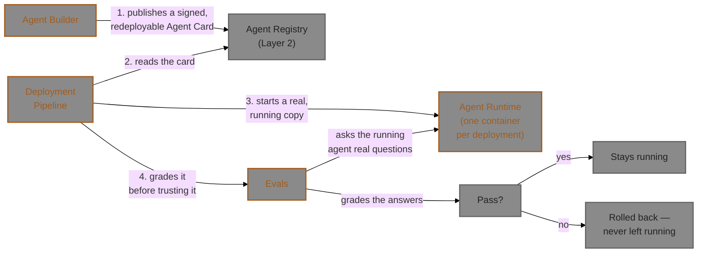

# Layer 4 — Agent Lifecycle

This is the top layer — it's where everything below finally gets used to actually build, deploy,
and grade a real AI agent, start to finish.

*This is the one layer built around a genuine hand-off between separate services, in a fixed
order: an agent gets built and published, then deployed as a real running copy, then graded
before it's trusted to stay live. A failing grade rolls the deployment back automatically —
nothing broken is ever left running unattended.*

## Objective

This layer answers the question every other layer has been building toward: **"can we actually
build one of these agents, put it into real use, and trust that it's good enough?"**

- **Agent Builder** is where an agent is actually assembled — given a role, a goal, a
  personality, and a task, it runs a real AI-agent framework to produce a working agent, then
  publishes a signed, reusable description of it.
- **Agent Runtime** is not a service you interact with directly — it's the actual "body" a
  deployed agent runs in: one shared, reusable container image that gets personalized with a
  specific agent's role/goal/personality each time it's started.
- **Deployment Pipeline** is the release manager — it takes a published agent, actually starts it
  running for real, checks it's healthy, and grades it before letting it stay live. A failing
  grade means it's automatically shut back down, never left running broken.
- **Evals** is the grader — runs a set of test questions against either a raw AI model or an
  actual deployed agent, and scores the answers using AI-judge techniques, the same way a teacher
  grades an exam.

This is genuinely the newest and most complex layer to build, and it shows: this is where the
platform found the most real bugs during construction (see the tradeoffs section below) — which
also makes it the most instructive layer to read carefully if you want to understand what
actually goes wrong when building a system like this for real.

## Frameworks and technology choices

| Service | Core technology | What it's for |
|---|---|---|
| Agent Builder | CrewAI (an open-source AI-agent framework) | Actually assembling and running an AI agent from a role/goal/personality/task description |
| Agent Runtime | CrewAI again, packaged as a reusable container image | The "body" a deployed agent actually runs inside |
| Deployment Pipeline | Temporal (the same workflow engine Approvals uses), Docker (to start/stop the actual agent container) | Reliably orchestrating a multi-step release process that can't be allowed to leave things half-done |
| Evals | DeepEval and Ragas (two independent open-source AI-grading libraries) | Judging whether an agent's answers are actually good, using two different grading approaches at once |

**Why two grading libraries, not one:** an AI judging another AI's work is itself imperfect and
occasionally inconsistent — found live, not assumed. Using two independent engines and requiring
*both* to agree something is correct makes the grading meaningfully more reliable than trusting a
single AI judge's opinion.

## Design choices and tradeoffs

**One shared, reusable agent "body," not a custom container built for every single agent
(D-087).** Every deployed agent runs inside the *same* container image — what makes it a
specific agent (its role, goal, personality) is injected as configuration the moment it starts,
not baked into a one-off build. Tradeoff: much faster and simpler to deploy a new agent (no build
step needed each time), at the cost of every deployed agent sharing one identity/trust level with
the platform rather than each getting its own — acceptable for a reference platform, flagged as
something a real production system would likely want to revisit.

**Agent Cards gained a proper "how to rebuild me" section only after a real gap was found
(D-088).** Originally, the information needed to actually redeploy a built agent (its role, goal,
personality, task) wasn't durably saved anywhere — not in the build record, not in the published
card. This was discovered by trying to build Deployment Pipeline and realizing there was nothing
to read. Fixed by adding that information to the Agent Card itself, using the official extension
mechanism the underlying card standard already provides for exactly this kind of
platform-specific addition — not a proprietary bolt-on.

**Grading a deployed agent for real was a deliberate choice over a shortcut (D-089).** The
simpler option would have been to only ever grade the underlying raw AI model, never the actual
deployed, configured agent. The team chose the harder, more meaningful path: really start the
agent, really ask it real questions, really grade its real answers — proving the *specific
deployed configuration* behaves correctly, not just that the model underneath it is capable in
general.

**The same category of bug — code inside one container using the wrong address to reach
another — was found and fixed four separate times while building this layer (D-090 through
D-093).** Not four unrelated bugs: one underlying confusion (there are three different meanings
of "the address to reach something," depending on where the calling code runs), rediscovered in
four different specific spots because each spot looked different on the surface. See the
Cross-Cutting Runbooks file's "Docker networking" section for the full explanation — genuinely
worth reading in full if you're going to touch this layer's code, since it's the single most
repeated real mistake across this entire platform's construction.

**An API's own request shape was expanded after building revealed a real gap (D-094).** The
original plan for "deploy this agent" didn't ask which test suite should grade it before trusting
it live — an oversight only visible once the deployment step was actually being built and there
was nothing telling it which suite to use. Fixed by making that a required piece of information
the caller must supply, rather than having the system silently guess or skip grading entirely.

**A real, unresolved question was documented honestly rather than hidden or worked around
(D-095).** While proving that a deployment survives a worker process crashing mid-flight, the
underlying workflow engine's own safety-net timer fired roughly 30 minutes later than its
configured setting said it should — in this specific one-computer development setup. The
important half of this finding: nothing was actually lost or corrupted; the system recovered
correctly once the timer did fire. The unresolved half: *why* it took so much longer than
configured is not yet understood, and is written down as an open question rather than quietly
ignored or assumed to be fine.

**Agent Builder's `/ui` reuses the same pattern already shipped elsewhere, not a new stack
(D-096), and its design was corrected against the real `Build` row shape before being built
(D-101).** The earlier design pass had assumed a `status` column and visible role/goal fields;
reading `models.py` directly showed neither exists — `create_build` only ever persists a `Build`
row *after* kickoff, sign, and publish have all already succeeded, so a failed build is never a
browsable row, only a one-time error response. Role/goal aren't shown on the build detail screen
either, since the API genuinely has nowhere to read them back from afterward.

**Per-agent knowledge-base file uploads were deliberately deferred, not built, after checking
what it would actually take (D-102).** Reading `knowledge-service`'s real ingest/query code
first showed it's one global corpus with only a shared/private visibility split and no
per-agent scoping at all — wiring uploads straight into it as-is would let one agent's reference
material leak into every other agent's answers. Doing this properly needs a scope/tag field added
to `knowledge-service` itself plus a new CrewAI tool here to retrieve scoped to that tag, a
cross-service feature logged for later rather than half-built now.

**"Editing" a build is a new, versioned revision, never an in-place mutation (D-103).**
`POST /builds/{name}/revise` looks up the latest published version for that name, bumps it
(minor+1, patch reset — a revised role/goal/backstory/task is a behavior change, not a
patch-level fix), re-runs kickoff with the edited fields, and publishes a new card version plus a
new `Build` row; the original row and card are left untouched. This matches `Build`'s own
documented shape as an append-only audit trail, the same pattern as Sandbox's `executions` and
Guardrails' `checks` — mutating a row in place would have broken that pattern for the first time
in this codebase.

**`backstory` was made optional with a generated default, then removed from the UI entirely
(D-104).** It's CrewAI's own required `Agent` constructor field, confirmed against the installed
library — not something this harness invented, so it can't simply be dropped. But the user found
no value in writing one by hand across two rounds of feedback, so when omitted it's now
auto-generated from role/goal (`f"An AI agent acting as {role}, focused on: {goal}"`) rather than
asked for on the form.

## Key components

**Agent Builder (`agent-builder-service`, port 8102).** Given a role, goal, personality, and
task, runs a real CrewAI agent (which can genuinely call a tool through MCP Gateway Registry, not
just claim to), then signs and publishes the result as an Agent Card. Also looks up which eval
suites might be relevant to this new agent. Has its own `/ui` (D-096, D-101, D-103, D-104) — every
route needs a bearer token, no public-browse tier: a **Builds** list (successfully-persisted
builds only, with an Edit action per row), a **Build detail** view (name, `card_version`,
description, the "Instructions" field — the `task` field relabeled, wire name unchanged — and the
full raw CrewAI output), a **New Build** form (no `backstory` field, D-104), and an **Edit
(revise) mode** on that same form that calls `POST /builds/{name}/revise` instead of `POST
/builds`, pre-filling what's actually recoverable and saying plainly what isn't (role/goal).

**Agent Runtime (`agent-runtime`, not a standing service — built once as a reusable image, no
fixed port).** The actual "body" a deployed agent runs in. It's built into a container image
once; Deployment Pipeline starts a fresh, freshly-configured copy of it for every real
deployment. Exposes exactly one action: `/invoke` — ask this specific agent a question, get its
answer.

**Deployment Pipeline (`deployment-pipeline-service` + a separate
`deployment-pipeline-worker` process, port 8104).** The release manager: fetches a published
agent's redeploy information, starts a real Agent Runtime container configured as that specific
agent, waits until it's healthy, has Evals grade it for real, and either leaves it running (a
passing grade) or shuts it back down immediately (a failing grade). Uses the same durable
API+worker pattern as Approvals (Layer 3) — the worker process is the one with direct access to
start/stop containers.

**Evals (`evals-runner-service`, port 8103).** The grader. Fetches a test suite from Eval
Registry (Layer 2), asks every question in it to a target — either a raw AI model directly, or
(when Deployment Pipeline is using it as a gate) a specific real, running deployed agent — and
scores every answer with both grading engines. A question only counts as "passed" if every
grading check on it passed.

## Every file, script, and artefact in this layer

### `services/agent-builder-service/`

| File | What it does |
|---|---|
| `src/agent_builder_service/crew_layer.py` | Runs the actual CrewAI agent, including a tool call through MCP Gateway Registry |
| `src/agent_builder_service/mcp_gateway_registry_tool.py` | A small adapter letting a CrewAI agent call a tool through MCP Gateway Registry specifically, rather than a generic bypass (renamed from `agent_gateway_tool.py` / `AgentGatewayTool`, D-105) |
| `src/agent_builder_service/sync_token.py` | A version of the platform's badge-fetching logic built for CrewAI's own non-standard execution style |
| `src/agent_builder_service/models.py` | The database table recording every build attempt |
| `src/agent_builder_service/main.py` | The `/builds` (+ `/builds/{name}/revise`) endpoints: kick off a build, sign and publish the resulting card, look up relevant eval suites |
| `static/index.html` | The Builds / New Build / Edit (revise) page at `/ui` |
| `migrations/versions/0001_builds.py` | Creates the one table this service needs |
| `migrations/versions/0002_card_version.py` | Adds the `card_version` column (D-103) |

### `services/agent-runtime/`

| File | What it does |
|---|---|
| `src/agent_runtime/crew_layer.py` | Runs one CrewAI agent, configured entirely from environment settings, with automatic recovery if its AI-model badge goes stale mid-task |
| `src/agent_runtime/main.py` | The one endpoint: `/invoke` — ask this agent a question |
| `Dockerfile` | Builds the one shared, reusable image every deployment starts a fresh copy of |

No database — this component holds no memory of its own between calls.

### `services/deployment-pipeline-service/`

| File | What it does |
|---|---|
| `src/deployment_pipeline_service/temporal_workflow.py` | The actual multi-step release process: fetch config, start container, wait for healthy, grade it, roll back or keep it — the heart of this layer |
| `src/deployment_pipeline_service/activities.py` | Every real action the release process performs: talking to Agent Registry, starting/stopping the actual Docker container, calling Evals |
| `src/deployment_pipeline_service/temporal_types.py` | Plain data shapes shared across the workflow, kept deliberately simple for the same reason as Approvals' own version of this file |
| `src/deployment_pipeline_service/worker.py` | The separate, always-running process that actually executes the release steps (and is the one with real access to Docker) |
| `src/deployment_pipeline_service/models.py` | The database table recording every deployment and its outcome |
| `src/deployment_pipeline_service/main.py` | The web API: request a deployment, check its status, stop a running one |
| `migrations/versions/0001_deployments.py` | Creates the one table this service needs |

### `services/evals-runner-service/`

| File | What it does |
|---|---|
| `src/evals_runner_service/llm_gateway_target.py` | Asks questions directly to the raw AI model |
| `src/evals_runner_service/agent_runtime_target.py` | Asks questions to a real, specific deployed agent instead |
| `src/evals_runner_service/eval_registry_client.py` | Fetches a test suite's questions and expected answers from Eval Registry |
| `src/evals_runner_service/metrics/deepeval_engine.py` | Grades an answer using the DeepEval library |
| `src/evals_runner_service/metrics/ragas_engine.py` | Grades the same answer using the Ragas library, independently |
| `src/evals_runner_service/models.py` | The database table recording every grading run and its results |
| `src/evals_runner_service/main.py` | The `/runs` endpoint: run a suite against a chosen target, grade every answer, save the results |
| `static/index.html` | A simple web page for browsing past grading runs |
| `migrations/versions/0001_runs.py`, `0002_judge_model.py` | Creates the results table, then later adds a column recording which AI model did the grading (kept separate from the model *being* graded, to avoid a model unfairly favoring its own answers) |

## How the key logic actually works

**Building and publishing an agent — `create_build()` (`agent_builder_service/main.py`).** Runs
a real CrewAI agent against the supplied role/goal/personality/task, genuinely calling a tool if
the task calls for one (checked via CrewAI's own event log, not just assumed from the output text
— a model can *say* it used a tool without actually invoking one). The agent's construction
details are then packed into the Agent Card's official "extension" section (this is D-088's fix)
and the card is signed and published to Agent Registry. If that exact agent name+version was
already published (e.g. a retried request), the duplicate-publish error is treated as success,
not a failure — the card already exists and is fetchable, so there's nothing to redo.

**Recovering from a stale AI-model badge mid-task — `CrewLayer.run()` (used by both Agent Builder
and Agent Runtime).** Fetches a fresh badge, attempts the AI task. If that attempt fails in a way
that looks like an authentication problem, it force-refreshes the badge and tries exactly once
more before giving up. This exists because a badge can look valid by the container's own internal
clock while having genuinely expired in real time — see the Cross-Cutting Runbooks file's Token
TTLs section.

**Orchestrating an entire deployment — `DeploymentWorkflow`
(`deployment_pipeline_service/temporal_workflow.py`).** This is the layer's central piece of
logic, worth understanding step by step: (1) fetch the agent's redeploy configuration from its
published card; (2) start a real Agent Runtime container, configured as that specific agent; (3)
wait for it to report healthy, with a timeout; (4) run a real eval-suite grading pass against that
specific running container; (5) if grading passed, leave it running and record success; if
grading failed — or if any earlier step failed — stop and remove the container and record
exactly what went wrong. Two of these steps (starting the container, running the grading pass)
are deliberately *not* automatically retried on failure: a blind retry after a partial failure
could start a second container without ever learning about the first one, leaving an orphan
running unnoticed. Failing cleanly and requiring a fresh deployment request is the safer choice.

**Starting the actual agent container — `Activities.run_container()`.** Starts a new container
from the one shared Agent Runtime image, injecting that specific agent's role/goal/personality as
settings at startup (not baked into a custom image), and records which real network port Docker
assigned it so the platform can reach it. This is also exactly where D-093's networking bug lived
— the container must be explicitly told to join the platform's own network, or it comes up
looking healthy but genuinely can't reach anything else in the platform.

**Checking the new container is actually ready — `Activities.wait_healthy()`.** Repeatedly
checks the new container's health endpoint until it responds successfully or a timeout is
reached. This is exactly where D-092's networking bug lived: this check runs from inside the
*release-manager's own* container, checking on a *different* container's health — which needs a
different kind of address than either process would use to check on itself.

**Grading the real running agent — `Activities.run_eval_gate()`.** Calls Evals, explicitly
telling it to grade the real, specific, just-started container (not the raw underlying model) by
passing its actual network address. A deployment only counts as passed if *every* question in the
suite passed on *every* grading engine — a partial pass is still a fail.

**Grading one answer, twice, independently — Evals' `create_run()`.** For every question in a
suite, it asks the target (either the raw model or a specific deployed agent, chosen based on
what was requested) for an answer, then runs that answer through both grading engines separately.
A question only counts as passed if *both* engines agree it's correct — not just one. This
two-engine requirement exists because a single AI judge occasionally rationalizes an obviously
wrong answer as acceptable; requiring independent agreement catches that.

## What to watch out for when maintaining or enhancing this layer

- **Read the Cross-Cutting Runbooks file's Docker-networking section before touching Deployment
  Pipeline's container-starting or health-checking code.** This exact class of mistake has
  already been made and fixed four times in this platform; a fifth is very avoidable if you
  understand the underlying confusion first.
- **Never make `run_container` or `run_eval_gate` automatically retry on failure** without also
  solving the orphaned-container risk that retrying naively would reintroduce — this was a
  deliberate choice, not an oversight.
- **`temporal_types.py` must stay free of real application-code imports**, the same rule as
  Approvals' own version of this file (Layer 3) — and for the identical underlying reason (the
  workflow engine's own strict re-validation of this file).
- **If you add a new field to what "deploy this agent" requires**, update both the request format
  and the underlying data shape together — D-094 already added one required field after the
  fact; a future one should ideally be anticipated at the request-design stage next time, though
  this platform's own philosophy is to fix a real, found gap rather than guess ahead of time.
- **D-095's unexplained timer delay is still an open question, not resolved.** If you're doing
  serious work on Deployment Pipeline's reliability, this is the most valuable unanswered
  question to actually dig into — don't assume someone already figured out why it happened.
- **The two-grading-engines-must-agree design is there specifically because a single AI judge
  can be fooled or inconsistent.** If a future change ever makes it possible to pass a suite with
  only one engine's approval, that quietly removes a real safety property this system currently
  has — flag it clearly if that tradeoff is ever deliberately made.

## Common failures

- **A build succeeds, but the resulting agent can't be deployed later.** Check whether its
  published card actually carries the redeploy-configuration extension — cards published before
  D-088 genuinely lack it.
- **A deployment gets stuck in "deploying" for a very long time.** Check the durable workflow
  engine directly (see the Cross-Cutting Runbooks file) before assuming it's genuinely hung —
  D-095 documents a real, still-unexplained delay in how quickly this environment's own
  safety-net timer fires; a stuck-looking deployment may just be waiting on that.
- **The grading step returns a `502`-style error.** Check the *deployed agent's own* logs first,
  not the grader's — this is almost always the deployed container itself failing (commonly, it
  can't reach another platform service by name, the D-093 networking bug), not a problem with the
  grading logic itself.
- **"Stop this deployment" fails.** It only works on a deployment that's currently actually
  running — check its current status first.
- **A test suite that should obviously fail sometimes passes anyway, or vice versa.** A single AI
  grading engine occasionally disagrees with what a human would obviously conclude — this is why
  two independent engines are required to agree. If you're writing a new test suite specifically
  meant to fail, make sure it uses both engines, not just one, or it may pass more often than
  you'd expect.
